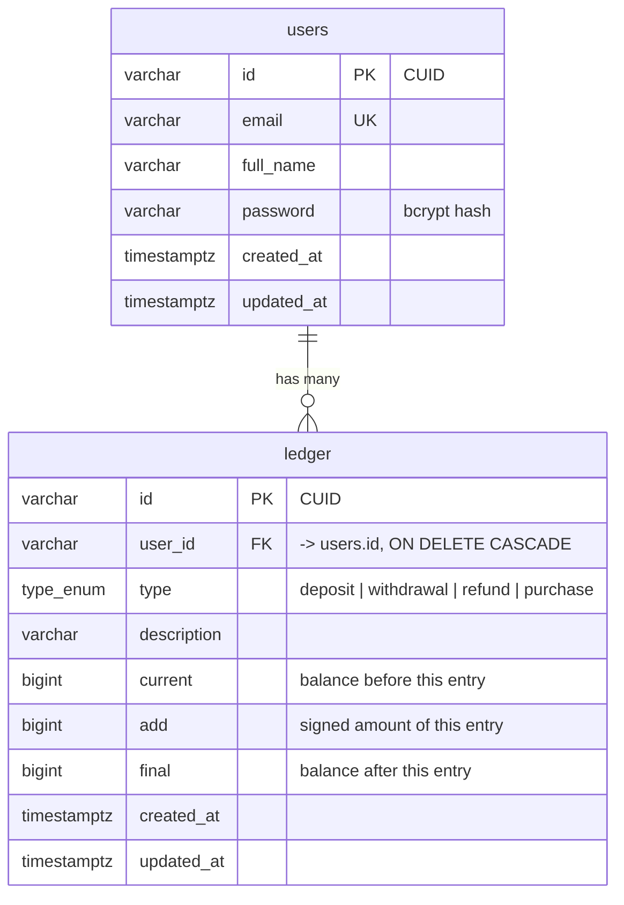
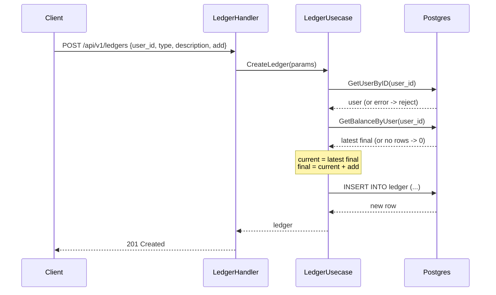

# Balance Ledger Database Design

> [!NOTE]
> **This is a personal learning project.** I built it to learn how to design a database for tracking user balances with a ledger, and how to wire that design into a small Go API. It is not production software, and it is not meant to be used as a library or template. Expect rough edges, and see [Learning notes](#learning-notes-and-known-gaps) for the ones I know about.

## What I wanted to learn

The core question behind this repo:

> How do you store a user's balance so that it is always explainable, auditable, and never "just a number that changed"?

The answer I explored is a **balance ledger**: instead of keeping a mutable `balance` column on the user, every change to the balance is written as a new, append-only row. Each row records the balance **before**, the **amount** that changed, and the balance **after**. The user's current balance is simply the `final` value of their latest ledger row.

Along the way I also practiced:

- Writing schema migrations with [golang-migrate](https://github.com/golang-migrate/migrate)
- Generating type-safe Go code from SQL with [sqlc](https://sqlc.dev)
- Structuring a Go service into handler / usecase / repository layers
- Building an HTTP API with [Fiber](https://gofiber.io) and [pgx](https://github.com/jackc/pgx)
- Password hashing with bcrypt and token auth with [PASETO](https://paseto.io)
- Running Postgres locally with Docker Compose

## The database design

### Entity relationship



### `users`

Defined in [`db/migrations/000001_create_users_table.up.sql`](db/migrations/000001_create_users_table.up.sql).

| Column       | Type          | Notes                                |
| ------------ | ------------- | ------------------------------------ |
| `id`         | `varchar` PK  | CUID generated by the app            |
| `email`      | `varchar`     | `UNIQUE NOT NULL`                    |
| `full_name`  | `varchar`     | `NOT NULL`                           |
| `password`   | `varchar`     | bcrypt hash, never the raw password  |
| `created_at` | `timestamptz` | defaults to `now()`                  |
| `updated_at` | `timestamptz` | defaults to `now()`                  |

### `ledger`

Defined in [`db/migrations/000002_create_ledger_table.up.sql`](db/migrations/000002_create_ledger_table.up.sql).

| Column        | Type          | Notes                                                       |
| ------------- | ------------- | ----------------------------------------------------------- |
| `id`          | `varchar` PK  | CUID generated by the app                                   |
| `user_id`     | `varchar` FK  | references `users(id)`, `ON DELETE CASCADE`                 |
| `type`        | `type_enum`   | `deposit`, `withdrawal`, `refund`, `purchase`               |
| `description` | `varchar`     | human-readable reason for the entry                         |
| `current`     | `bigint`      | balance **before** this entry                               |
| `add`         | `bigint`      | amount of this entry (negative for money leaving)           |
| `final`       | `bigint`      | balance **after** this entry, always `current + add`        |
| `created_at`  | `timestamptz` | defaults to `now()`, used to find the latest entry          |
| `updated_at`  | `timestamptz` | defaults to `now()`                                         |

### Design decisions

- **Append-only history.** A balance change is a new row, not an `UPDATE`. The full history of how a balance got to its value is always in the table.
- **Snapshot of before and after on every row.** Storing `current`, `add`, and `final` means each row is self-describing. You can verify any row on its own (`final = current + add`) and verify the chain (`row[n].current = row[n-1].final`).
- **Balance is derived, not stored.** There is no `balance` column on `users`. The current balance is read from the most recent ledger row:

  ```sql
  -- db/query/ledger.sql (GetBalanceByUser)
  SELECT final
  FROM ledger
  WHERE user_id = $1
  ORDER BY created_at DESC
  LIMIT 1;
  ```

  A user with no ledger rows has a balance of `0`.
- **Money as integers.** Amounts are `bigint` (for example the smallest currency unit such as cents or rupiah) to avoid floating point rounding errors.
- **Typed transactions.** A Postgres `ENUM` restricts `type` to the four known kinds of movement.
- **Ownership through a foreign key.** Every ledger row belongs to a user, and deleting a user cascades to their ledger.
- **App-generated CUIDs** as primary keys instead of serial integers, so IDs are not guessable or sequential.

### Worked example

A user deposits 100,000, buys something for 25,000, then gets a 5,000 refund:

| type       | description          | current | add     | final   |
| ---------- | -------------------- | ------- | ------- | ------- |
| deposit    | Top up               | 0       | 100000  | 100000  |
| purchase   | Buy coffee beans     | 100000  | -25000  | 75000   |
| refund     | Partial refund       | 75000   | 5000    | 80000   |

The current balance is `80000`, the `final` of the newest row. Every step that led there is still visible.

## How writing a ledger entry works

The logic lives in [`internal/ledger/usecase.go`](internal/ledger/usecase.go) (`CreateLedger`):



The client only sends the amount (`add`). The server always computes `current` and `final` itself, so the client can never set a balance directly.

## Project architecture

```
.
├── cmd/server/main.go            # entrypoint: loads env, connects DB, registers routes
├── db/
│   ├── migrations/               # golang-migrate up/down SQL (the schema)
│   ├── query/                    # hand-written SQL queries fed to sqlc
│   └── sqlc/                     # sqlc-generated Go code (used by the app)
├── internal/
│   ├── auth/                     # register + login (handler, usecase, dto, errors)
│   ├── ledger/                   # ledger entries + balance (handler, usecase, errors)
│   ├── middlewares/              # PASETO bearer-token auth middleware
│   ├── postgresql/               # pgx pool + Repository wrapping sqlc.Querier
│   └── token/                    # PASETO v2 token create/verify
├── pkg/
│   ├── response/                 # error type carrying an HTTP status
│   └── utils/                    # bcrypt, CUID, current user, Fiber error handler
├── build/server/Dockerfile       # multi-stage build, runs as non-root
├── docker-compose.yml            # Postgres (port 5433) + Adminer (port 8082)
├── sqlc.yaml
└── Makefile
```

Each feature follows the same layering:

```
routes.go -> handler.go (HTTP in/out) -> usecase.go (business rules) -> postgresql.Repository (sqlc queries) -> Postgres
```

## API

Base path: `/api/v1`

| Method | Path                | Auth   | Description                                         |
| ------ | ------------------- | ------ | --------------------------------------------------- |
| POST   | `/auth/register`    | -      | Create a user (`email`, `full_name`, `password`)    |
| POST   | `/auth/login`       | -      | Returns a PASETO token (valid 1 hour) and the user  |
| POST   | `/ledgers`          | -      | Create a ledger entry (`user_id`, `type`, `description`, `add`) |
| GET    | `/ledgers`          | -      | List entries: `?user_id=...&offset=<page>&limit=<n>` |
| GET    | `/ledgers/:id`      | -      | Get one ledger entry                                |
| GET    | `/ledgers/balance`  | Bearer | Current balance of the logged-in user               |

Example:

```bash
curl -X POST localhost:8002/api/v1/auth/register \
  -d '{"email":"me@example.com","full_name":"Me","password":"secret"}' \
  -H 'Content-Type: application/json'

curl -X POST localhost:8002/api/v1/ledgers \
  -d '{"user_id":"<user id>","type":"deposit","description":"Top up","add":100000}' \
  -H 'Content-Type: application/json'
```

## Running it locally

Requirements: Go 1.22+, Docker, and the [`migrate`](https://github.com/golang-migrate/migrate) CLI.

```bash
cp .env.example .env     # app runs on :8002, Postgres on :5433
make docker.up           # start Postgres + Adminer (http://localhost:8082)
make migrate.up          # create the users and ledger tables
make run                 # start the API
```

Other targets: `make migrate.down`, `make docker.down`, `make docker.build`, `make sqlc` (regenerate Go code from `db/query`).

## Learning notes and known gaps

Things I noticed while building this, and what I would study or change next. Keeping them here is part of the learning.

- **Race condition on concurrent writes.** `CreateLedger` reads the latest balance and then inserts in two separate statements with no transaction or lock. Two requests for the same user at the same time can both read the same `current` and one update is effectively lost. Next step: wrap it in a transaction and lock per user (for example `SELECT ... FROM users WHERE id = $1 FOR UPDATE`), or add a per-user sequence number with a unique constraint.
- **"Latest row" depends on `created_at`.** Two rows with the same timestamp make the latest balance ambiguous. A monotonic per-user sequence column would be more reliable.
- **No index for the hot query.** `GetBalanceByUser` and `ListLedgerByUser` would benefit from an index on `ledger (user_id, created_at DESC)`.
- **No balance rules enforced.** Nothing stops a withdrawal from making `final` negative, and the sign of `add` is not checked against `type`. A `CHECK (final = current + add)` and a `CHECK (final >= 0)` constraint would push these rules into the database.
- **Ledger rows are mutable.** `UpdateLedger` and `DeleteLedger` queries exist, which goes against the append-only idea. A real ledger would correct mistakes with a new reversing entry instead.
- **Route order.** `GET /ledgers/:id` is registered before `GET /ledgers/balance`, so the `balance` path can be captured by `:id`.
- **Pagination naming.** The `offset` query param is actually used as a page number (`OFFSET (page - 1) * limit`), and `0` produces a negative offset.
- **Ledger endpoints are mostly unauthenticated** and `POST /ledgers` trusts `user_id` from the request body.
- **PASETO key is hardcoded** in `internal/token/paseto.go` instead of read from the environment.
- **Duplicate generated code.** The app imports `db/sqlc`, while `sqlc.yaml` writes to `internal/postgresql/sqlc`.
- **Down migration** removes the enum by deleting from `pg_type` before dropping the table; `DROP TABLE` then `DROP TYPE type_enum` is the clean way.

## Tech stack

Go 1.22, Fiber v2, PostgreSQL, pgx v5, sqlc, golang-migrate, PASETO v2, bcrypt, CUID, Docker.
